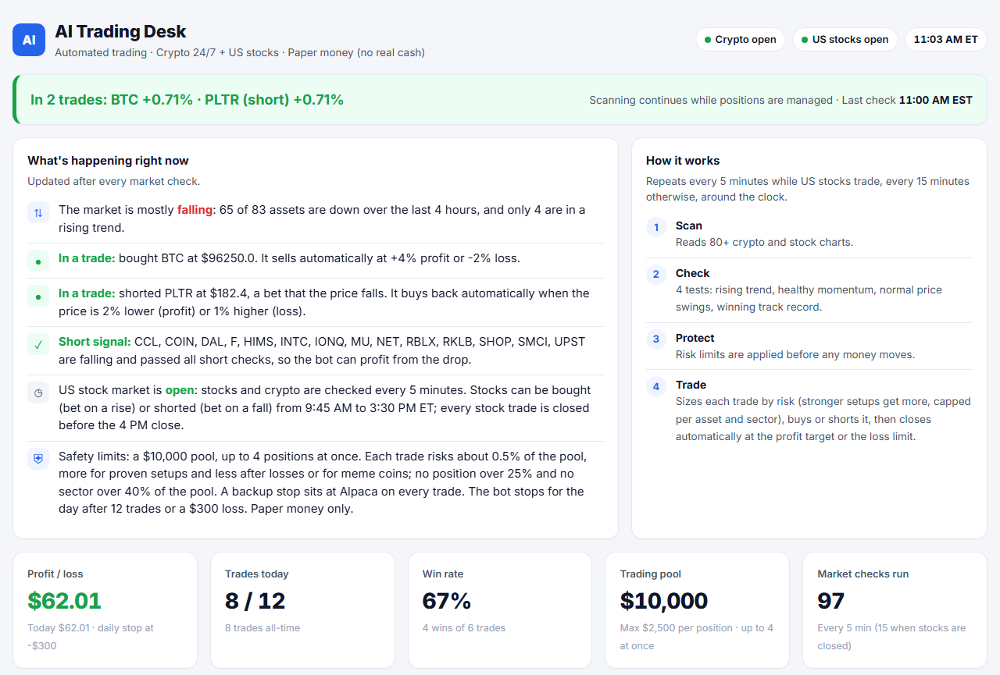
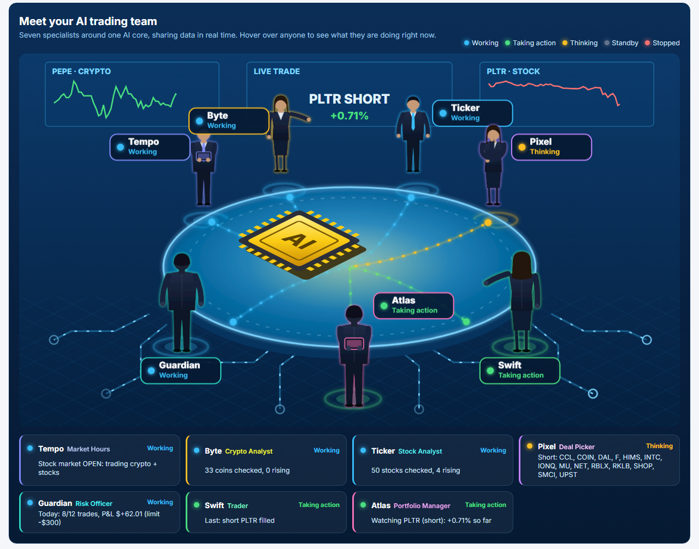
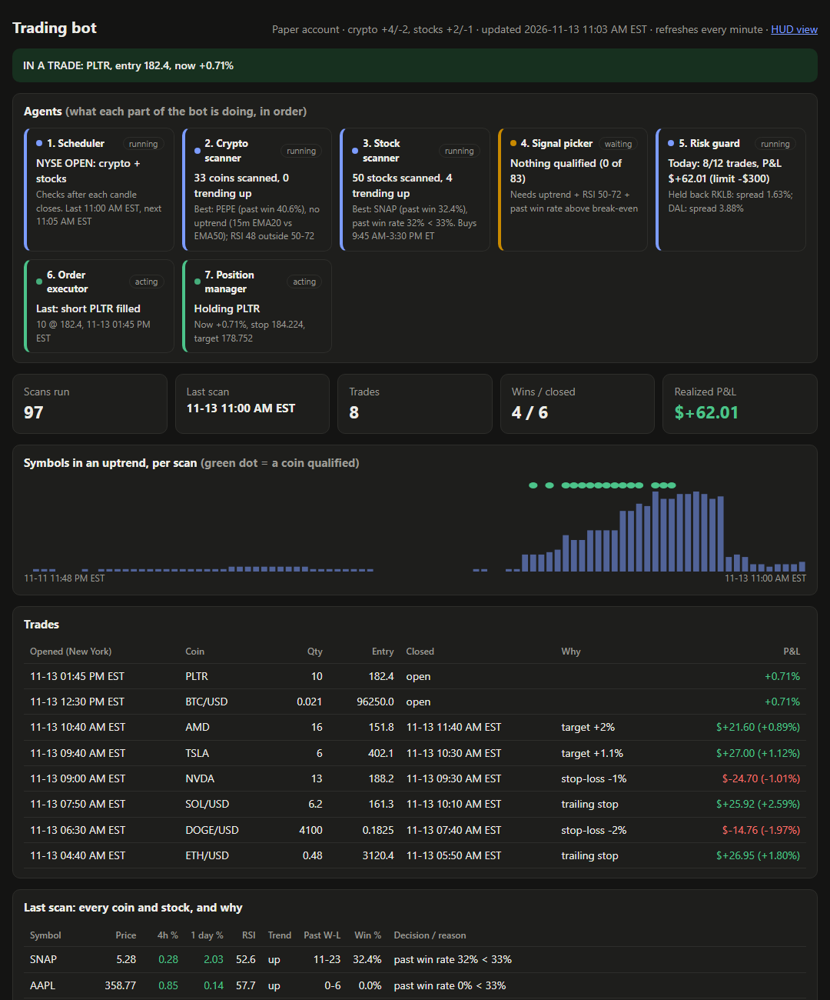
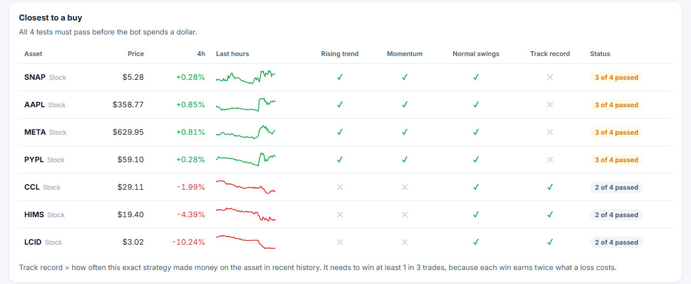
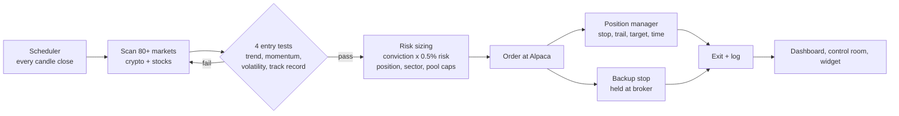

<div align="center">

# AI Trading Desk

**An autonomous trading bot for crypto and US stocks: risk-managed, fully visible, built on Alpaca.**

It scans 80+ markets every few minutes, sizes each trade by how much it's worth risking, protects every position with two independent stops, and shows you exactly what it's thinking in a live control room.


-success)




<sub>Screenshots use sample data for illustration. They are not real or projected results.</sub>

</div>

---

## Why it's different

Most retail bots are a black box with one stop-loss and an all-in position size. This one is built around **not blowing up**:

| | Typical bot | AI Trading Desk |
|---|---|---|
| Position size | Fixed amount or all-in | Sized by risk: ~0.5% of the pool per trade, scaled by conviction |
| Diversification | None | Max 25% per position, 40% per sector, 4 positions at once |
| Learning from results | None | Shrinks size after losing streaks and repeat losers; grows it for setups that keep working |
| Stops | One stop, in the bot | Bot stop **plus** a backup stop order held at the broker, so you're covered even if the PC dies |
| Profit protection | Fixed target | Trailing stop arms at +2% and locks in gains as price rises |
| Visibility | Log file | Live control room, dashboard and desktop widget |

## Features

**Trading engine** (`crypto_bot.py`)
- **Two markets, one brain.** Crypto around the clock; US stocks during market hours, both **long and short**.
- **Four-test entry filter:** rising trend (EMA 20 vs 50), healthy momentum (RSI band), normal volatility (ATR band) and a **track record** on that exact asset. A setup must have paid off often enough in recent history to beat break-even.
- **Conviction-based sizing.** Each trade's size reflects the setup's historical edge, how much history backs it, the bot's own recent record in that market, losing streaks, recent losses on the same symbol, and asset class (meme coins get half size).
- **Sector-aware portfolio:** 11 stock sectors plus crypto and meme coins, each capped so one theme can't sink the account.
- **Exits:** fixed stop, profit target, a trailing stop with a breakeven-plus floor, and a time limit. Stock trades close before the 4 PM bell.
- **Broker-side safety stops.** Every position gets a stop order resting at Alpaca, kept in sync as the trailing stop moves.
- **Built to survive:** spread and liquidity checks, live bid/ask pricing (not stale last trades), exact-quantity sells, retries with backoff, crash-safe restarts that re-adopt open positions and restore their trailing highs, and an incremental bar cache.

**Visibility**
- **Control room** (`hud.py`): an animated isometric view of seven "specialists" around an AI core. Each one is a real stage of the pipeline (scheduler, crypto and stock scanners, signal picker, risk guard, order executor, position manager), showing live status.
- **Dashboard** (`dashboard.py`): every trade, every scan, and the reason each asset was or wasn't bought.
- **Desktop widget** (`widget.pyw`): always-on-top Windows widget with bot status, open trades, live holdings and P&L.

**Manual mode** (`trader.py`): a step-by-step day-trading pipeline (scan → entry → exit plan → 10,000-run Monte Carlo → sizing → risk check → order) that waits for your "yes" before every order. See [RUNBOOK.md](RUNBOOK.md).

## Screenshots

<table>
<tr>
<td width="50%"><br><sub><b>Control room:</b> each specialist is a live pipeline stage.</sub></td>
<td width="50%"><br><sub><b>Dashboard:</b> trades, scans and the reason behind every decision.</sub></td>
</tr>
<tr>
<td colspan="2"><br><sub><b>Closest to a buy:</b> all four tests must pass before a dollar moves.</sub></td>
</tr>
</table>

## How it works



## Quick start

```bash
git clone https://github.com/abhishek-donekal/alpaca-trading-bot.git
cd alpaca-trading-bot
cp .env.example .env              # add your Alpaca PAPER keys
python connect.py                 # check the connection
python crypto_bot.py auto --usd 10000
```

Then open `trader/hud.html` or `trader/dashboard.html` in a browser, or double-click `widget.pyw` on Windows.

Requirements: Python 3.10+, standard library only, and a free [Alpaca](https://alpaca.markets) account.

## Configuration

Risk limits live in `trader/config.json` and at the top of `crypto_bot.py`:

| Setting | Default | Meaning |
|---|---|---|
| Pool | `--usd 10000` | Money the bot may use |
| `RISK_PCT` | 0.5% | Base risk per trade, before conviction scaling |
| `MAX_POS_PCT` | 25% | Largest single position |
| `MAX_SECTOR_PCT` | 40% | Largest exposure to one sector |
| `MAX_OPEN` | 4 | Positions open at once |
| `max_daily_loss_usd` | $300 | Daily loss limit |
| Crypto exits | stop -2%, target +4%, trail arms at +2% | Per-market rules in `MK` |

## Project layout

```
crypto_bot.py      trading engine (scan, size, enter, manage, exit)
hud.py             control room page
dashboard.py       dashboard page
widget.pyw         Windows desktop widget
trader.py          manual, approve-every-order pipeline
connect.py         Alpaca connection helper
trader/config.json risk limits
.claude/skills/    analysis skills used by trader.py (MIT, see DAY-TRADER-LICENSE)
```

## Security

- API keys live only in your local `.env`, which is git-ignored. Nothing in this repo contains keys.
- Paper trading is the default. Switching to live requires changing `APCA_API_BASE_URL` yourself.

## Disclaimer

This software is provided for educational and research purposes. It is **not financial advice**. Trading involves substantial risk of loss, past or simulated performance does not guarantee future results, and automated systems can fail in ways that lose money. Run it on a paper account first and only ever trade money you can afford to lose.

## License and commercial use

Copyright © 2026 abhishek-donekal. All rights reserved. See [LICENSE](LICENSE).
Licensing, customization or a hosted setup: [open an issue](https://github.com/abhishek-donekal/alpaca-trading-bot/issues) or contact the author through GitHub.
